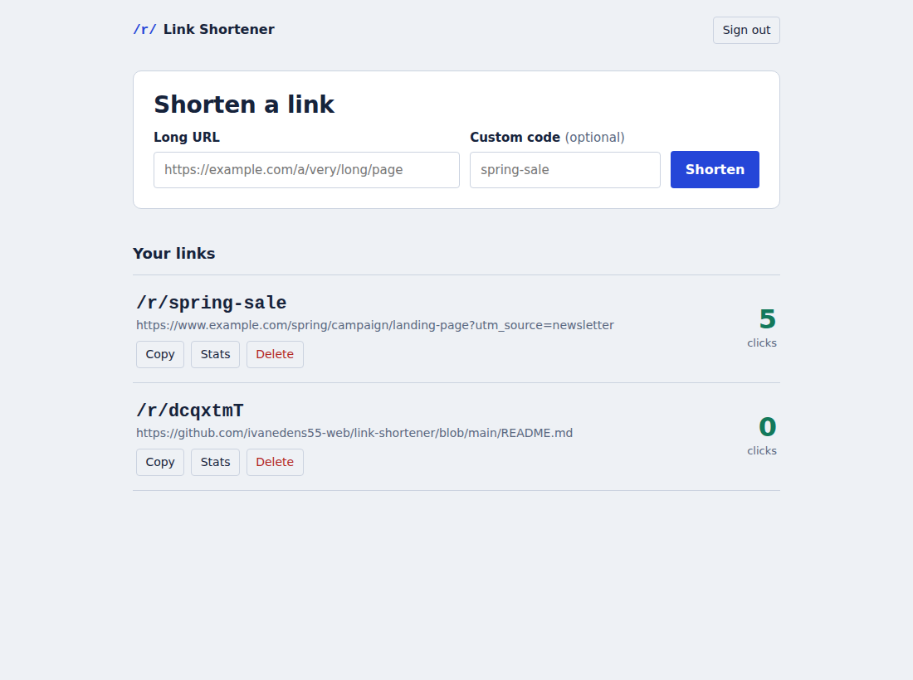
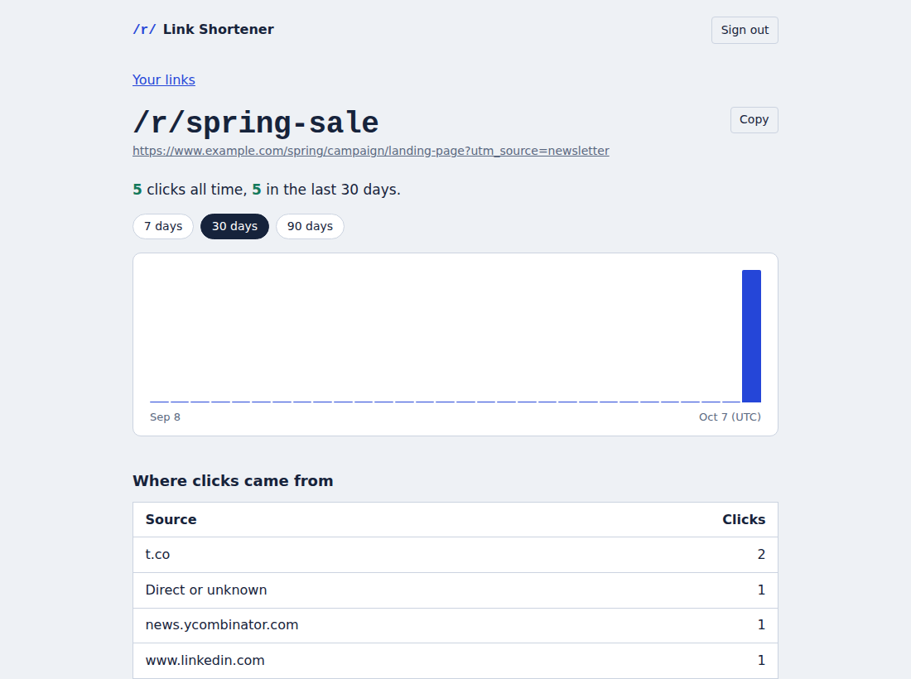
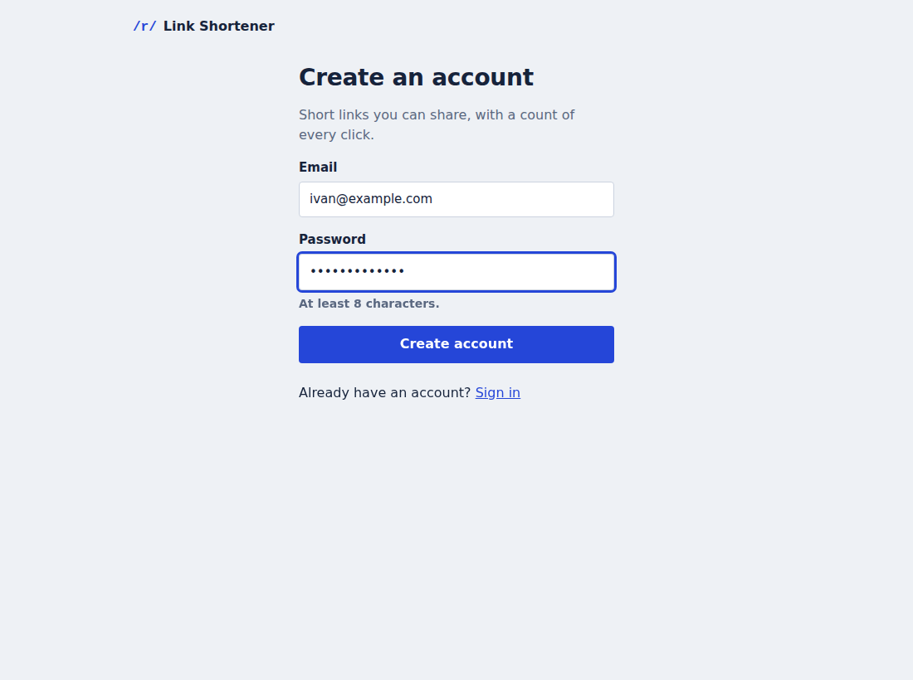
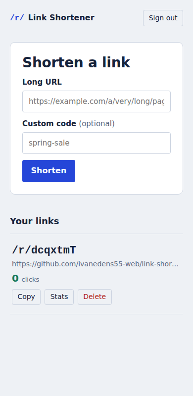
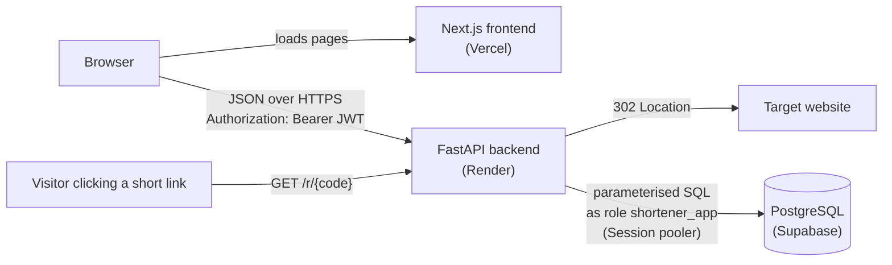

# Link Shortener with Click Analytics

Turns long URLs into short links and counts every click. Users sign in, create and manage their own links, and see a per-link stats page with daily clicks and top referrers. The backend handles the redirect itself, so every click is recorded in the database before the visitor is sent on.

**Live demo:** frontend `https://<your-app>.vercel.app` · API `https://<your-api>.onrender.com/health`
(The API runs on Render's free tier and sleeps when idle: the first request can take ~50 seconds.)

## Features

- Email + password accounts (Argon2id hashing, short-lived JWT access tokens)
- Create short links with a random 7-character code or your own custom code
- Public redirect at `/r/{code}` that records the click, then redirects with HTTP 302
- Dashboard of your links with live click counts, copy and delete
- Stats page: all-time total, clicks per day (7 / 30 / 90 days, zero days included) and top 5 referrers
- Users can only see and change their own links (others' links return 404)
- API contract in `docs/openapi.yaml`, enforced by a test

## Screenshots

| Dashboard | Stats |
|---|---|
|  |  |

| Sign up | Mobile |
|---|---|
|  |  |

## Tech stack

- **Backend:** Python 3.12, FastAPI, Pydantic v2, psycopg 3 (connection pool), PyJWT, argon2-cffi
- **Frontend:** Next.js 16 (App Router), React 19, TypeScript, plain CSS
- **Database:** PostgreSQL 16 (Supabase), tables prefixed `shortener_`
- **Hosting:** Render (backend, Frankfurt) · Vercel (frontend) · Supabase (database)
- **Testing:** pytest against a real Postgres database; GitHub Actions CI

## Architecture



The frontend never talks to the database. It only renders pages and calls the API. All state lives in Postgres; all validation, ownership checks and counting happen in the backend.

### How each architecture rule is applied

| Rule | Where it's implemented |
|---|---|
| 1. Separate layers | `frontend/lib/api.ts` is the only code that talks to the backend; it uses `NEXT_PUBLIC_API_URL` and nothing else. The backend returns JSON only (the one exception is the 302 redirect, which is the point of the product). |
| 2. API-first | `docs/openapi.yaml` was written before the code. `backend/tests/test_contract.py` fails if a route exists in one but not the other. |
| 3. Single source of truth | Click counts, the stats window total and the daily series are all computed in SQL (`backend/app/repository.py`). The frontend only scales bar heights for display. |
| 4. Schema design | `db/schema.sql`: foreign keys with `on delete cascade`, `NOT NULL`, `UNIQUE` (email, code), `CHECK` (lowercase email, code format, URL scheme and length). Two indexes, each commented with the query it serves. |
| 5. Validation at the boundary | `backend/app/schemas.py` (bodies, `extra="forbid"`), plus `Path`/`Query` limits in the routers. Only `http`/`https` URLs are accepted. All SQL uses placeholders. |
| 6. Stateless auth | `backend/app/security.py`: Argon2id hashes, HS256 JWT with `exp`, 30-minute default. Token storage trade-off below. |
| 7. Least privilege | `shortener_app` role has only `SELECT/INSERT` (+ `DELETE` on links); it can't update, truncate, create or drop (tested in `test_security.py`). Every links query filters by `user_id`. Secrets only in env vars. RLS on; Data API roles have no access. |
| 8. Error handling | `backend/app/errors.py`: one `{"error": {"code", "message"}}` format for 401/404/409/422/500. Stack traces go to the server log only (tested). |
| 9. CORS and headers | CORS origins from `CORS_ORIGINS` (refuses `*` at startup). Backend sets `nosniff`, `X-Frame-Options`, `frame-ancestors` CSP, `Referrer-Policy`, and HSTS in production (`main.py`). Frontend CSP in `next.config.ts`. |

### Token storage

The access token is kept in `sessionStorage`. The options and why:

- **httpOnly cookie:** JavaScript can't read it, so XSS can't steal it. But the frontend (vercel.app) and API (onrender.com) are different sites, so it would be a third-party cookie, which browsers increasingly block, and it brings CSRF protection into play. Worth it with a custom domain for both.
- **localStorage:** survives restarts, but any XSS can read it, and it lingers for a long time.
- **Memory only:** safest against persistence, but every refresh signs you out.
- **sessionStorage (chosen):** survives a refresh, cleared when the tab closes. Still readable by XSS, so the risk is reduced with a short token lifetime (30 min), a strict Content-Security-Policy, React's output escaping, and no `dangerouslySetInnerHTML`.

## Project structure

```
link-shortener/
├── backend/
│   ├── app/
│   │   ├── main.py          # app factory: middleware, CORS, headers, routes
│   │   ├── config.py        # env settings, fails fast on unsafe values
│   │   ├── db.py            # connection pool
│   │   ├── errors.py        # one JSON error format
│   │   ├── security.py      # Argon2id + JWT
│   │   ├── schemas.py       # Pydantic request/response models
│   │   ├── repository.py    # all SQL (parameterised)
│   │   ├── codes.py         # short-code generation, referrer parsing
│   │   ├── deps.py          # DB connection + current user dependencies
│   │   └── routers/         # auth.py, links.py, redirect.py
│   ├── tests/               # 65 tests (unit, contract, real-Postgres API tests)
│   ├── requirements.txt / requirements-dev.txt
│   └── .env.example
├── frontend/
│   ├── app/                 # pages: dashboard, login, register, links/[id] (stats)
│   ├── components/          # Header, AuthForm, CopyButton
│   ├── lib/                 # api.ts (only backend client), auth.ts, useRequireAuth.ts
│   ├── next.config.ts       # Content-Security-Policy + security headers
│   └── .env.example
├── db/schema.sql            # tables, indexes, constraints, app role, RLS
├── docs/openapi.yaml        # the API contract
├── .github/workflows/tests.yml
├── render.yaml              # Render blueprint (backend)
└── README.md
```

## Setup (Windows / PowerShell)

### 1. Database (Supabase)

1. In your Supabase project, open **SQL Editor**, paste `db/schema.sql` and run it.
2. Set the app role's password (generate a long random one, keep it out of the repo):
   ```sql
   alter role shortener_app with login password '<long-random-password>';
   ```
3. **Settings → Data API:** make sure the Data API is off (the backend connects directly).
4. **Connect → Session pooler:** copy the string, then change the user to the app role:
   `postgresql://shortener_app.<project-ref>:<password>@aws-0-<region>.pooler.supabase.com:5432/postgres`

### 2. Backend

```powershell
cd backend
python -m venv .venv
.\.venv\Scripts\Activate.ps1
pip install -r requirements-dev.txt
Copy-Item .env.example .env   # then fill in DATABASE_URL and JWT_SECRET
python -c "import secrets; print(secrets.token_urlsafe(48))"   # paste as JWT_SECRET
uvicorn app.main:create_app --factory --env-file .env --reload
```

API docs: http://localhost:8000/docs

### 3. Frontend

```powershell
cd frontend
npm install
Copy-Item .env.example .env.local
npm run dev
```

Open http://localhost:3000.

### 4. Tests

```powershell
cd backend
.\.venv\Scripts\Activate.ps1
python -m pytest -q
```

Without test database variables, 13 unit and contract tests run and 52 database tests are **skipped**. The full suite runs on every push in GitHub Actions (Postgres 16 container). To run it locally you need a disposable Postgres (local install or `docker run -e POSTGRES_PASSWORD=postgres -p 5432:5432 postgres:16`), with `db/schema.sql` applied, then:

```powershell
$env:TEST_DATABASE_URL = "postgresql://shortener_app:<pw>@localhost:5432/shortener_test"
$env:TEST_ADMIN_DATABASE_URL = "postgresql://postgres:<pw>@localhost:5432/shortener_test"
python -m pytest -q
```

> ⚠️ The tests **wipe the shortener tables** before each test. Never point them at your real Supabase database.

## Deployment

**Backend (Render):** New → Blueprint → select this repo (uses `render.yaml`, region Frankfurt). Set:
`DATABASE_URL` (Session pooler string as `shortener_app`), `PUBLIC_BASE_URL` (the Render URL, e.g. `https://link-shortener-api.onrender.com`), `CORS_ORIGINS` (your Vercel URL, no trailing slash). `JWT_SECRET` is generated by Render.

**Frontend (Vercel):** import the repo, set **Root Directory** to `frontend`, add `NEXT_PUBLIC_API_URL` = your Render URL, deploy. It's baked in at build time, so redeploy after changing it.

Then put the final Vercel URL in Render's `CORS_ORIGINS` and redeploy the backend.

## How it works

1. **Sign up / sign in.** The backend hashes the password with Argon2id. Login returns a JWT (`sub` = user id, `exp` = 30 min). The frontend sends it as `Authorization: Bearer …`.
2. **Create a link.** The backend validates the URL (http/https only, ≤ 2048 chars) and the optional custom code, then inserts it. Random codes come from `secrets` (62⁷ ≈ 3.5 trillion options); on the rare collision it retries.
3. **Someone clicks.** `GET /r/{code}` looks up the code (unique index), inserts a row into `shortener_clicks` with the time and the referrer's **host only**, then returns a **302** with `Cache-Control: no-store`. A 301 would be cached by browsers and later clicks would never reach the server.
4. **Stats.** One SQL query uses `generate_series` to build every day in the window (so zero-click days still appear), left-joined to the click counts. Another groups by referrer host.

## Limitations

- Short links live on the API domain (`…onrender.com/r/abc1234`), so they aren't very short without a custom domain.
- Free Render instances sleep: the first click after idle time takes ~50 seconds to redirect.
- No rate limiting, so someone could create many links or inflate click counts. Bots and link-preview crawlers (Slack, WhatsApp) also count as clicks.
- Any http/https URL is accepted. There's no malware/phishing check, so it could be abused to disguise harmful links.
- No refresh tokens: you're signed out after 30 minutes or when the tab closes.
- A missing short link returns a JSON 404 rather than a friendly web page.
- Click counts use `count(*)` per request; fine at portfolio scale, would need a counter or rollup table at high volume.

## Future improvements

- Rate limiting on link creation, login and redirects
- Bot filtering (user-agent rules) and unique-visitor counts
- Custom short domain, with httpOnly-cookie auth on the same site
- Safe Browsing check on target URLs
- QR codes, link expiry, editing target URLs
- Friendly HTML 404 page for unknown codes

## License

MIT, see [LICENSE](LICENSE).
